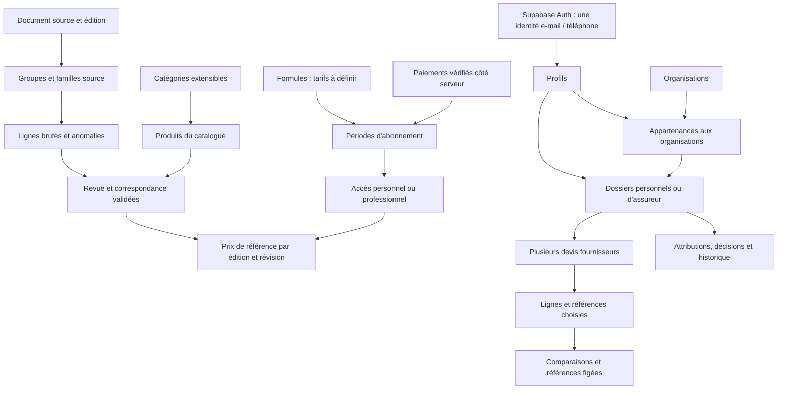

# Check - Schéma Supabase du pilote

Projet choisi par le porteur : **check-app**, référence `nhdwiuukewfofaexbxmi`, URL `https://nhdwiuukewfofaexbxmi.supabase.co`. PostgreSQL distant : 17.11. La base était vide lors de l'inspection initiale du 23 octobre 2026.

Le schéma du pilote comprend **21 tables applicatives dans `public` et 4 tables internes dans `private`**. La migration est installée dans `check-app` et les types TypeScript ont été générés depuis cette base.

## Organisation

## Tables

| Domaine | Tables | Rôle |
| --- | --- | --- |
| Identités | `profiles` | Profil d'un utilisateur Supabase Auth ; le rôle n'est pas un champ modifiable de ce profil. |
| Organisations | `organizations`, `organization_memberships` | Assureurs et autres organisations ; appartenance active, membre ou responsable. |
| Classement | `categories`, `units` | Hiérarchie métier extensible et unités conservant les conditionnements distincts. |
| Source | `reference_sources`, `source_groups`, `source_families` | Éditions, empreintes et classement d'origine. Les ordres et codes source peuvent être réutilisés ou absents. |
| Préparation | `reference_entries`, `reference_entry_issues` | Cellules brutes, localisation, valeurs extraites et suivi de revue. |
| Catalogue | `products`, `reference_prices` | Produit identifié et prix revu par édition/révision, avec correspondance vérifiée. |
| Accès payant | `subscription_plans`, `subscriptions`, `subscription_seats` | Formules, périodes d'accès et accès professionnels par siège si cette facturation est retenue. |
| Paiements | `payments` | Références de paiement et statut vérifié ; accès en lecture selon propriétaire ou rôle de facturation. |
| Dossiers | `quote_dossiers`, `quote_estimates`, `quote_lines`, `comparison_runs`, `quote_dossier_events` | Un dossier d'assureur regroupe plusieurs devis et leurs lignes ; comparaisons figées, attribution, décision et historique. |
| Usage | `favorites`, `reference_reports` | Favoris personnels et signalements volontaires sur une référence ou un résultat accessible. |
| Interne | `private.staff_members` | Fonctions catalogue/facturation attribuées par le serveur. |
| Interne | `private.payment_events` | Événements de paiement vérifiés et dédoublonnés. |
| Interne | `private.audit_events` | Journal des changements de catalogue, d'accès et de facturation. Le contenu des dossiers n'est pas copié dans ce journal. |
| Interne | `private.reference_imports` | Suivi des lots et rapprochement final des effectifs attendus. |

Les offres fournisseurs, stocks, commandes et livraisons seront ajoutés dans les étapes dédiées. Les organisations et catégories permettent de les rattacher au même socle.

## Règles du modèle

- Une ligne du répertoire garde son identifiant de provenance. Les numéros 6128, 6133 et 6167 restent réutilisés dans la source ; aucune contrainte ne les transforme en clé unique.
- Les cellules, montants extraits et emplacements source sont protégés contre la réécriture et la suppression. Les corrections sont portées par une référence revue, avec justification, sans effacer la source.
- Le classement source et les catégories métier sont séparés. Une famille peut proposer un classement ; une ligne peut être classée individuellement, notamment dans « Autres entretiens ».
- La publication demande une source approuvée, des anomalies traitées, un classement validé, un produit publié, une unité compatible, une correspondance vérifiée et des bornes cohérentes. Les prix publiés ne sont pas modifiés en place : une nouvelle révision conserve les versions précédentes.
- Les montants utilisent `NUMERIC`, la devise est explicite et aucun taux fiscal n'est supposé. Les unités paire, jeu, ensemble et bidon restent distinctes.
- Une souscription représente une période. Un paiement vérifié n'active qu'une période ; les clés de paiement et d'événement permettent d'éviter les doubles traitements. La période activée est immuable et un renouvellement crée une nouvelle période.
- L'accès vérifie les dates, le paiement et l'appartenance active à l'organisation à chaque consultation. Le modèle accepte une facturation professionnelle par organisation ou par siège ; ce choix commercial reste ouvert.
- Une comparaison future conservera les entrées, résultats, références et version de calcul dans un instantané serveur immuable. L'expiration de l'abonnement ne retire pas l'historique appartenant à l'utilisateur.

## Droits d'accès

RLS est activé sur les 25 tables, avec des privilèges SQL explicites. Les fonctions d'autorisation sont dans le schéma interne `private`, avec chemin de recherche fixé et vérification de l'identité courante. Les décisions de rôle et d'abonnement utilisent les lignes de la base ; les métadonnées modifiables de l'utilisateur ne leur donnent aucun droit.

| Accès | Droits prévus dans le schéma |
| --- | --- |
| Visiteur | Catégories actives, unités et formules commercialement actives. |
| Compte sans accès actif | Son profil, ses favoris existants, ses paiements personnels et ses dossiers historiques. |
| Abonné personnel | Catalogue publié et nouveaux dossiers personnels. |
| Collaborateur d'assureur | Appartenance active ; dossiers qu'il a créés ou qui lui sont attribués. |
| Responsable d'assureur | Tous les dossiers de sa propre organisation ; peut attribuer un dossier à un membre actif. |
| Administrateur catalogue | Catalogue et données en préparation ; aucun accès général au contenu des dossiers. |
| Administrateur facturation | Suivi de facturation ; aucun accès général au contenu des dossiers. |
| Backend privilégié | Écritures administratives, validation des paiements et production des résultats, après contrôle de l'utilisateur appelant. |

Les clients peuvent modifier uniquement les champs autorisés de leur profil et les entrées de leurs dossiers autorisés. Ils ne peuvent pas s'attribuer un rôle, activer un abonnement, publier un prix ou fabriquer un résultat serveur.

## Import initial

Les lots SQL sont générés par `scripts/reference/build_supabase_import.py`, à partir des fichiers et empreintes de l'étape 3. Ils sont idempotents : un nouvel import ne réinitialise pas les décisions de revue existantes. Les identifiants UUID sont créés par la base ; les liens sont retrouvés avec les clés de provenance.

Effectifs attendus :

- 1 source, 24 groupes et 578 familles détaillées ; 11 unités normalisées.
- 419 lignes pour 415 numéros distincts : 334 prêtes pour revue, 85 nécessitant une revue.
- 87 signalements ouverts sur ces 85 lignes.
- 24 catégories racines ; seul le domaine Automobile est actif. Le classement fin attend la curation du catalogue.
- 0 produit publié, 0 prix publié et 0 abonnement actif.
- 2 formules inactives, sans montant ni durée : particulier et assureur.

Les compteurs sont rapprochés avant de marquer l'import terminé. L'import distant est maintenant `completed` : 24 groupes, 578 familles, 419 entrées et 87 signalements (tous encore ouverts pour revue). `supabase/inspect.sql` fournit une vue de lecture des effectifs et des droits. Le contrôle Expo (`npm run check`) passe avec TypeScript et ESLint.

## Suite du développement

La prochaine réalisation visible reste la proposition d'interface de l'étape 4, selon le choix d'avancer au ressenti. Le socle de l'étape 5 est préparé en avance à la demande du porteur.

La première intégration applicative utilise Google Authentication. Le rattachement e-mail/téléphone et le prestataire SMS sont reportés jusqu'à la configuration du service OTP. Les formules commerciales, le paiement automatique et ses webhooks restent également à définir ; aucune décision de prix ou d'outil de paiement ne doit être prise dans cette étape. L'administration de revue et le calcul des comparaisons restent à développer. Le schéma prépare ces parcours ; il ne simule pas leur fonctionnement.

Les abonnements et les paiements ne sont pas encore intégrés. Pour le pilote professionnel, une appartenance active à une organisation assureur donne temporairement accès au catalogue et à l'espace dossiers ; l'accès personnel reste régi par les abonnements vérifiés. Cette exception de pilote et les nouveaux RPC attendent l'application de la migration `insurer_quote_workflow` à Supabase.

Les règles de conservation et de fermeture des comptes professionnels et des données de facturation devront être précisées avant les comptes réels du pilote.

## Références techniques

- [RLS Supabase](https://supabase.com/docs/guides/database/postgres/row-level-security).
- [Privilèges SQL et accès à la Data API](https://supabase.com/docs/guides/api/securing-your-api).
- [Profil lié à Supabase Auth](https://supabase.com/docs/guides/auth/managing-user-data).
- [Migrations](https://supabase.com/docs/guides/deployment/database-migrations).
- [Dictionnaire des données source](./DICTIONNAIRE_REFERENCE.md).
